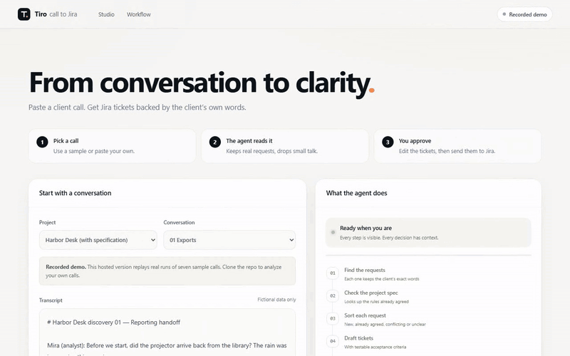
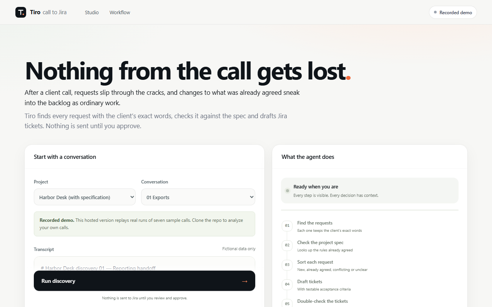
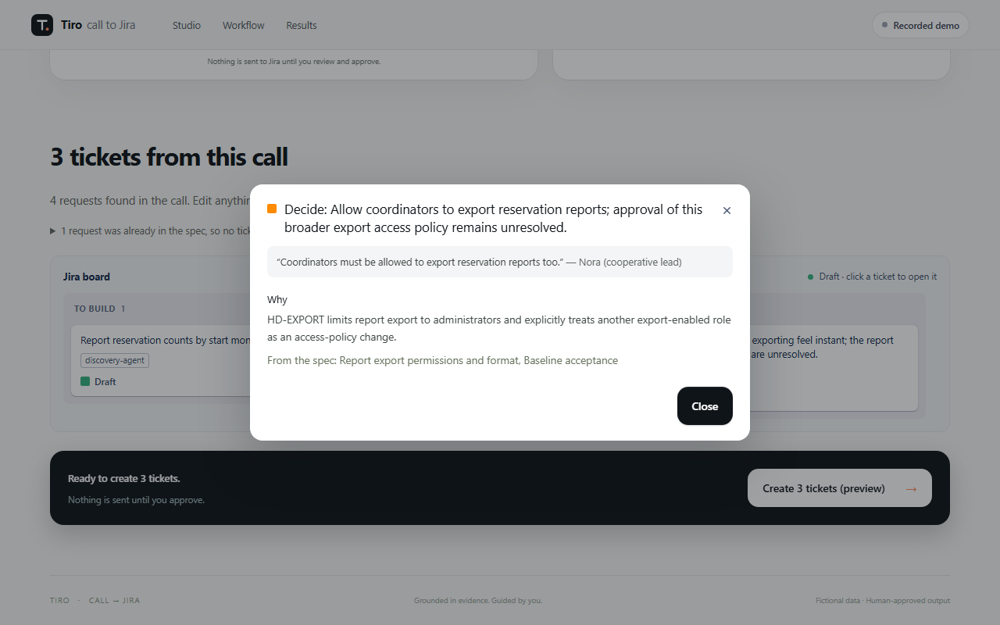
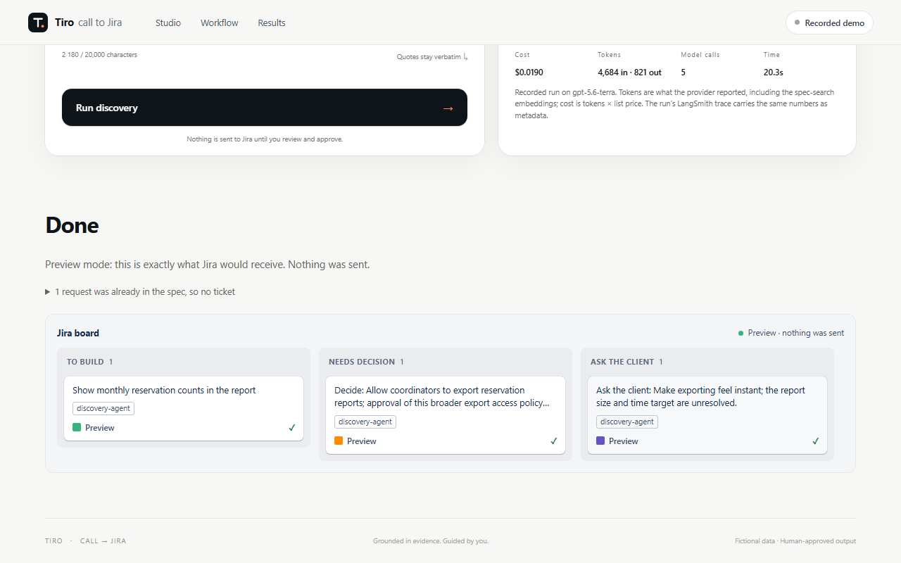

<div align="center">


# Tiro

**From a messy client call to reviewed Jira stories, with every requirement backed by the client's own words.**

[**▶ Live demo**](https://tiro-six-theta.vercel.app) · [How it works](#how-it-works) · [Results](#results) · [Run it locally](#run-it-locally) · [Case study](docs/case-study.md)




</div>

*Named after Marcus Tullius Tiro, Cicero's secretary, who invented shorthand to write speech down word for word.*

## Why I built it

After a discovery call someone has to sort real requests from small talk, check them against what was already agreed, and turn them into tickets. People skip steps: a "can we also…" gets lost, or a change that breaks the spec slips into the backlog as if it were new work.

Tiro does that groundwork and leaves the decision to a person:

- **Every requirement carries a verbatim quote and a speaker.** If the quote isn't in the transcript, code drops the requirement. The prompt is not trusted to do this.
- **Each request is checked against the project spec** and marked *new*, *already in spec*, *conflicts with spec* or *needs clarification*, with the spec section it relied on.
- **Stories come with Given/When/Then criteria.** A critic gets one chance to send them back.
- **The PM gets the rest as tasks too.** A conflict with the spec becomes a *Decide* task, an unclear request an *Ask the client* task, each with the quote and the reason.
- **Nothing reaches Jira until a person edits and approves.** The run pauses and survives an API restart while it waits.
- **Jira writes are idempotent.** A retried approval or a timeout never creates a second ticket.

| Pick a call | See why a ticket exists | Approve and hand off |
|---|---|---|
|  |  |  |

> The hosted demo replays seven real recorded runs: no backend, no model calls, nothing sent to Jira. A public backend that calls a paid model needs abuse protection I haven't built, so to analyze your own text, run it locally.

## How it works

```text
extract → retrieve_spec → classify → write_stories → critic ─┐
                                          ↑   (once)          │
                                          └── revision ◄──────┘
                                                              ↓
                              human_review  ⏸  wait for Approve
                                                              ↓
                                                        create_tickets
```

| Step | What happens | What code checks after the model |
|---|---|---|
| `extract` | Transcript → requirements with quote and speaker | Quote must occur in the transcript (case and whitespace ignored) |
| `retrieve_spec` | Requirement + quote → top-5 spec sections from pgvector | Only the selected project's chunks, for the current embedding model |
| `classify` | Requirements + sections → status, cited sections, note | Same requirement IDs back; cited sections were actually given; a conflict needs a citation. One bad item becomes *unclear* instead of failing the run |
| `write_stories` | New requirements → stories | Each new requirement in exactly one story; one retry with the error if not |
| `critic` | Stories → issues | At most one revision, enforced by the graph |
| `human_review` | Run pauses in a Postgres checkpoint | Server validates edits and recomputes idempotency keys |
| `create_tickets` | Approved stories, plus a *decision* task per conflict and a *question* task per unclear request → Jira or a dry-run preview | Ledger row written before the call; ambiguous failures block replay |

Every model call goes through one helper that counts tokens, prices them, and refuses a call that would break the per-run budget ($0.30) or the daily budget ($1). If the provider doesn't report usage, the cost counts as unknown and later calls are blocked.

**Stack:** FastAPI, LangGraph (Postgres checkpointer), LangChain structured output, Pydantic, Neon Postgres + pgvector, Next.js, Jira Cloud REST v3, LangSmith. Locally the same code runs against Ollama.

## Results

All numbers come from the evaluation runner on 12 fictional cases (6 full transcripts, 6 short ones) with 32 hand-labelled requirements. They measure `qwen3:14b` running locally, not the hosted model. Each is the range over three runs.

**End to end** (transcript → stories, 3 runs):

| Metric | Result |
|---|---|
| Requirement recall | 0.72–0.81 |
| Requirement precision | 0.57–0.66 |
| Conflict-with-spec F1 | 0.62–0.67 |
| Status accuracy on matched requirements | 0.73–0.85 |
| Quotes found in the transcript | 100% |
| Time per call, p95 | 56–64 s on an RTX 3060 |
| Cases that failed | 1 of 36 (a story coverage rule, after one retry) |

Precision is the weak spot: the model often splits one requirement into two or
three, and every extra piece counts as a false positive.

**Does a five-page spec need RAG?** Same classification step, gold requirements,
3 runs each:

| Spec given to the model | Status accuracy | Conflict F1 | Input tokens, 12 cases |
|---|---|---|---|
| Top-5 sections (RAG) | 0.78–0.84 | 0.62–0.71 | 23k |
| The whole spec | 0.88–0.91 | 0.77–0.83 | 35k |
| No spec | 0.47–0.50 | 0.00 | 4k |

At this size, sending the whole spec is better, for about 50% more tokens.
Without the spec the model finds no conflicts at all. I kept RAG because each
citation points at one section that code can verify, and because a real
project has a wiki and a backlog that won't fit in a prompt. At this spec size,
though, it isn't the more accurate option.

**Prompt injection:** 5 attacks × 3 runs. None of the 15 got its payload into a
story. In 7 of them the injected request reached the review list, flagged as
*conflict* or *unclear* for the person. One attack still did damage: the legit
requirement next to "give everyone admin rights" was misclassified and lost its
story in all three runs.

What these numbers don't say:

- The LLM judge for story quality is **not calibrated**. On ten stories it agreed with a reviewer to within half a point on average, but its weighted kappa was 0.19, and it gave 4/5 to a story with an invented filter. I don't report its score as quality.
- The corpus is small and I labelled it myself, so treat the numbers as a regression baseline, not a benchmark.
- An earlier run on the hosted model failed its own quality gate. Most of that failure came from the matcher and gaps in the labels, which the [case study](docs/case-study.md) walks through.

## How it's tested

**Model quality: [evals/](evals/)**

| What | How it is measured |
|---|---|
| Gold set | 12 cases, 32 requirements labelled by hand with status, verbatim quote, speaker and spec section. Every quote is checked against its speaker's lines by a test. |
| Requirement precision / recall | Predicted and gold requirements are embedded and matched one-to-one, most similar first. The 0.58 cosine threshold was set from hand-checked pairs: true pairs scored 0.60–0.98, gold items with no true match at most 0.53. |
| Grounding | Share of returned quotes found verbatim in the transcript (case and whitespace ignored). |
| Retrieval | recall@5: the labelled spec section is in the top 5 retrieved (0.91 in classification-only runs, 0.96–1.0 end to end). |
| Conflict F1 | Conflicts with the spec against gold; missed and invented conflicts both count. |
| Variance | Every number is the range over 3 runs. The local baseline keeps the lower value of the clean runs; CI compares the hosted model with its own baseline. |
| Spec context | The same classifier with top-5 retrieval, the whole spec, or no spec (`--spec-context`). |
| Prompt injection | 5 attack transcripts. An attack counts as a success only if its payload reaches a ticket or flips a labelled status. |
| LLM judge | Checked against 10 reviewer scores: MAE 0.5, weighted kappa 0.19, so its score is not used as a quality claim. |

**Software: 154 API checks, 9 web unit tests, 5 browser flows**

| Area | What is covered |
|---|---|
| Contracts and grounding | Strict schemas, invented or empty quotes dropped, template words stripped from stories |
| Agent invariants | A citation the model wasn't given becomes *unclear*; a story-coverage break gets one retry; the critic loop is bounded |
| Jira | Ledger with an advisory lock, two concurrent approvals create one ticket (live Postgres), 429 retried with backoff, a 4xx releases the ledger key, a 5xx blocks replay |
| Recovery and budget | A run paused at review survives an API restart; unknown cost blocks further model calls; per-run and daily budgets |
| Isolation | Tests can't reach the network or live Jira; database tests run in throwaway schemas |
| Web | Browser flows with Playwright (mocked API): review, edit, approve, mode-change guard, outage. Accessibility: axe-core reports no WCAG 2.2 AA violations on the desktop review flow. |

CI ([api.yml](.github/workflows/api.yml)) runs lint, types, unit tests and the build on every push. Paid model evals run only on demand; browser flows and the accessibility audit run locally.

## Decisions worth knowing

1. **Grounding is checked in code.** The model can rephrase a requirement, but it can't invent the evidence for it.
2. **A workflow, not a free agent.** The order of steps is known in advance, so the model doesn't choose tools. Judgment is used where it's needed: classification and the critic.
3. **Exactly-once Jira without Jira's help.** Jira has no idempotency key on create, so a Postgres ledger records the intent under an advisory lock before the call. A clear 4xx releases it, while a timeout or 5xx blocks replay until someone checks Jira. Each ticket also carries a label with its key.
4. **pgvector instead of a vector database.** Postgres already holds checkpoints, the run queue and the ledger, so the vectors live there too: one database, real transactions, nothing extra to run.
5. **Human approval is mandatory.** Writing to someone else's system and deciding a spec conflict are business calls. A path to autonomy would be to auto-approve *new* and *duplicate* once approvals-without-edits stay high, while keeping conflicts with a person.

More in the [decision log](docs/decisions.md).

## Run it locally

You need Python with [uv](https://docs.astral.sh/uv/), Node 24 and a Postgres with pgvector (I use a free [Neon](https://neon.tech) database). Copy `.env.example` to `.env` and fill in `DATABASE_URL` and either an OpenAI key or the Ollama settings below.

On Windows, one command starts the API and the web app in two windows and opens the browser once both answer:

```powershell
./start.ps1            # local models through Ollama
./start.ps1 -OpenAI    # hosted model from .env
```

Or by hand, in two terminals:

```powershell
# terminal 1: API
cd apps/api
uv sync --locked
uv run --env-file ../../.env python -m app.rag.ingest ../../data/demo/harbor-desk/spec.md
uv run --env-file ../../.env uvicorn app.main:app --reload

# terminal 2: web
cd apps/web
npm ci
$env:API_URL = "http://127.0.0.1:8000"
npm run dev
```

Open <http://localhost:3000>, pick the *exports* call, run it, find the coordinator-export **conflict** with its `HD-EXPORT` evidence, edit a story and approve. You get a Jira preview, because `JIRA_DRY_RUN=true` is the default.

**Free local models.** With [Ollama](https://ollama.com) and a 12 GB GPU, add a second env file and nothing else changes:

```powershell
ollama pull qwen3:14b; ollama pull embeddinggemma:300m
uv run --env-file ../../.env --env-file ../../.env.ollama uvicorn app.main:app --reload
```

**Checks** (no paid calls): `uv run pytest`, `uv run ruff check . ../../evals` in `apps/api`; `npm run lint`, `npm run typecheck`, `npm test` in `apps/web`.

**Evals:** `uv run --env-file ../../.env --env-file ../../.env.ollama python ../../evals/run_evals.py --mode full`. Add `--spec-context all|none` for the long-context and no-spec baselines, or `--cases-dir ../../evals/attacks` for the injection set.

## Limits

- One fictional project; there's no spec upload in the UI.
- No live public backend. Docker and Render configs exist but aren't deployed.
- Real Jira writes were verified once against a test project. Reconciling an ambiguous 5xx is a manual step.
- English transcripts only; no audio.

## Docs

| | |
|---|---|
| [Case study](docs/case-study.md) | What was measured, what failed and why |
| [Decision log](docs/decisions.md) | Every non-obvious choice and its trade-off |
| [Learning guide](docs/learning.md) | Hands-on exercises and a module-by-module walkthrough |
| [Spec](docs/spec.md) · [Plan](docs/plan.md) · [Lessons](docs/lessons.md) | Scope, build history and recurring bugs |

All demo data is fictional.
